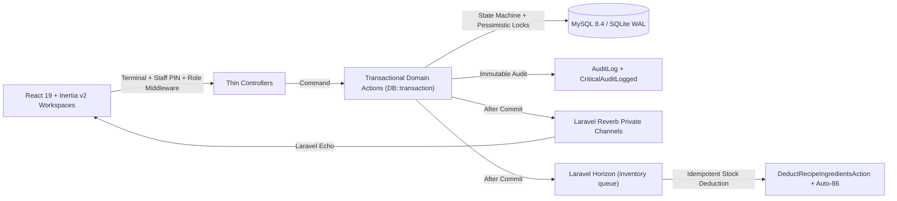

# Aurelia Dining Group — Enterprise Restaurant POS & Kitchen Display System

Production-grade **Multi-Branch Restaurant Point of Sale & Kitchen Display System (KDS)** built as a **Modular Monolith** with Laravel 13, PHP 8.3+, React 19, TypeScript, Inertia.js v2, Tailwind CSS v4, `shadcn/ui`, `motion.dev`, **SQLite (WAL) / MySQL 8.4+**, **Laravel Reverb**, and **Laravel Horizon**.

---

## Authentication & Demo Credentials (For Reviewers)

The application operates like a real hospitality POS with **two-layer authentication**:

1. **Terminal Device Activation (`/login`):** A Manager, Owner, or System Admin signs in once with email & password to bind the terminal session to a restaurant branch (`DTF`, `WFP`, or `APX`).
2. **Staff PIN Lock Screen (`/lock`):** All staff members at that branch appear on the lock screen. Tap any profile and enter their **4-digit PIN** to unlock directly to that role's home screen. Use **Lock Terminal** in the sidebar to switch staff roles quickly, or configure idle auto-lock (`POS_IDLE_LOCK_MINUTES=10`).

### Seeded Accounts & Staff PINs (Password: `password`)

| Role | Email Pattern | 4-Digit PIN | Home Screen |
| --- | --- | --- | --- |
| Enterprise System Admin | `sysadmin@aurelia.test` | `1234` | `/dashboard` |
| Restaurant Owner | `owner@aurelia.test` | `1234` | `/dashboard` |
| Branch Manager | `branch_manager.{dtf\|wfp\|apx}@aurelia.test` | `1234` | `/dashboard` |
| Cashier | `cashier.{dtf\|wfp\|apx}@aurelia.test` | `1111` | `/pos` |
| Waiter / Server | `waiter.{dtf\|wfp\|apx}@aurelia.test` | `2222` | `/tables` |
| Chef / Kitchen Staff | `chef.{dtf\|wfp\|apx}@aurelia.test` | `3333` | `/kitchen` |
| Kitchen Expediter (Expo) | `kitchen_expediter.{dtf\|wfp\|apx}@aurelia.test` | `4444` | `/kitchen` |
| Inventory Manager | `inventory_manager.{dtf\|wfp\|apx}@aurelia.test` | `5555` | `/inventory` |

> **Manager PIN Overrides:** Post-fire item voids, discounts above the branch threshold (`15%` at DTF), refunds, and blind cash shift variance approvals require PIN `1234` from a Manager, Owner, or System Admin.

---

## Workspaces & Role Permissions

- **`/dashboard`** — Daily sales curve, revenue by category donut, live orders, table status mix, trending dishes, out-of-stock alerts *(Owner, Admin, Manager)*.
- **`/pos`** — Category chips, dish grid, modifier sheet, open tabs, multi-round ticket firing, PIN voids & discounts, split-check settlement *(Admin, Owner, Manager, Cashier, Waiter)*.
- **`/orders`** — Live order board (`All`, `In Progress`, `Ready / Billing`, `Completed`), order details slide-over, thermal receipts, PIN refunds, split/cash/card settlement (including an interactive Simulated Card Reader approve/decline flow for partial-payment recovery) *(Admin, Owner, Manager, Cashier, Waiter)*.
- **`/tables`** — Zone floor plan (`Main Dining`, `Patio`, `Bar Counter`) with color-coded table states, running totals, elapsed seating timers, and table transfers *(Admin, Owner, Manager, Cashier, Waiter)*.
- **`/kitchen`** — Dark, high-contrast touch KDS with station tabs (`Grill`, `Cold & Garde Manger`, `Pastry`, `Bar`), SLA bump timers, sound chimes, and Expo serve gate *(Admin, Owner, Manager, Chef, Expediter)*.
- **`/menu`** — Branch availability (`86` toggles) and branch price overrides *(Admin, Owner, Manager, Inventory Manager)*.
- **`/inventory`** — Ingredient stock ledger, supplier deliveries, manual wastage, and automatic low-stock threshold 86 triggers *(Admin, Owner, Manager, Inventory Manager)*.
- **`/reports`** — Cross-branch comparison, P&L, COGS %, peak dining hours, and searchable audit trail *(Admin, Owner, Manager, Inventory Manager)*.
- **`/shifts`** — Cash drawer opening float, blind cash count on close, and variance approval *(Admin, Owner, Manager, Cashier)*.
- **`/settings`** — Branch tax/service rates, governance thresholds, and terminal device sign-out *(Admin, Owner, Manager)*.

---

## Architecture & Engineering Invariants



- **Strict Integer Accounting (Zero Floats):** All money uses signed/unsigned integer cents (`*_cents`), and all tax/service/discount/COGS ratios use integer basis points (`*_bps`) with `intdiv`.
- **Modular Monolith Boundaries (`tests/Architecture/ModuleBoundariesTest.php`):** Enforced via Pest Arch tests — `declare(strict_types=1);` in `App\Modules` & `App\Support`, controllers cannot bypass Actions via `DB` facade, and domain modules never depend on `App\Http`.
- **Concurrency & Idempotency:** Pessimistic `lockForUpdate()` inside `DB::transaction()`, payment `idempotency_key` enforcement, sorted ingredient locking on Horizon's `inventory` queue, and composite unique index `stock_movements(branch_id, reference_type, reference_id, ingredient_id)`.

---

## Local Development & Verification

```bash
composer install
npm install
cp .env.example .env
php artisan key:generate
php artisan migrate:fresh --seed

# Start dev servers
php artisan serve
npm run dev
php artisan reverb:start
php artisan horizon

# Verify test suite, types, and production bundle
php vendor/bin/pest
npm run types
npm run build
```
