# Aurelia Dining Group — Restaurant POS & Kitchen Display System

> A multi-branch hospitality **Point of Sale (POS)**, **Kitchen Display System (KDS)**, **Floor & Table Management**, **Recipe Inventory Engine**, and **Financial Audit Suite** built as a strictly bounded Laravel Modular Monolith with a responsive React 19 + Inertia v2 interface.

---

## Table of Contents

1. [Application Definition & Overview](#1-application-definition--overview)
2. [Problem Statement & Requirements](#2-problem-statement--requirements)
3. [Solution & Engineering Architecture](#3-solution--engineering-architecture)
4. [Tech Stack](#4-tech-stack)
5. [Implementation Stages](#5-implementation-stages)
6. [Modular Monolith & Domain Modules](#6-modular-monolith--domain-modules)
7. [User Personas, Roles & Seeded Credentials](#7-user-personas-roles--seeded-credentials)
8. [Core User Flows](#8-core-user-flows)
9. [Entity-Relationship Diagram (ERD)](#9-entity-relationship-diagram-erd)
10. [Application Features & Workspaces](#10-application-features--workspaces)
11. [Screenshots](#11-screenshots)
12. [Running, Walkthrough & Automated Testing](#12-running-walkthrough--automated-testing)

---

## 1. Application Definition & Overview

**Aurelia Dining Group POS** is an end-to-end restaurant operations platform supporting shared terminal hardware across multiple locations (`DTF — Downtown Flagship`, `WFP — Waterfront Patio`, and `APX — Airport Express`).

Rather than simulating single-user web forms, Aurelia models a real hospitality floor terminal:

1. **Terminal Device Binding (`/login`)**: A Manager, Owner, or System Admin signs in once with email and password to bind the terminal session to a branch.
2. **Fast Staff PIN Lock Screen (`/lock`)**: Service staff (Cashiers, Waiters, Chefs, Kitchen Expediters, Inventory Managers) tap their name and enter a 4-digit PIN to jump directly to their role workspace—allowing effortless shift handoffs on one shared iPad, desktop register, or kitchen display.

Once unlocked, every action—opening table tabs, adding modified dishes, firing rounds to kitchen prep stations, bumping KDS tickets, deducting recipe ingredients asynchronously, splitting checks, processing cash/card/QR payments, issuing PIN-protected refunds, and reconciling blind cash counts—executes deterministically with strict integer accounting and immutable audit logs.

---

## 2. Problem Statement & Requirements

### Problem Statement
Hospitality teams lose revenue, slow table turns, and suffer inventory shrinkage when POS registers, kitchen ticket printers/displays, cash drawers, and inventory ledgers live in disconnected tools. Shared terminals also face security vs. speed tension: requiring full email/password logins between every waiter or cashier slows rush service, while leaving unlocked accounts exposes voids, discounts, and cash refunds to shrinkage.

### Functional Requirements
- **Multi-Branch Terminal Auth & Role Isolation**: Terminal binding per branch, branch-filtered staff PIN unlock, automatic idle lock (`POS_IDLE_LOCK_MINUTES`), Manager/Owner PIN overrides for sensitive actions, and multi-branch switching restricted strictly to `EnterpriseSystemAdmin` and `RestaurantOwner`.
- **Table & Floor Plan Control**: Multi-zone dining layouts (`Main Dining`, `Patio`, `Bar Counter`), geometric table shapes with seat capacity, live running tab totals, elapsed dwell timers, table-to-table order transfers, and table state transitions (`available`, `occupied`, `billing`, `reserved`, `dirty`).
- **POS Order Lifecycle**: Dine-in and takeaway tabs, dish portion/modifier/seat customization, draft cart quantity adjustments and unfired tab cancellation, multi-round kitchen firing, automatic service charge + tax calculation, and branch-configurable discount PIN gates.
- **Kitchen Display System (KDS)**: Real-time dark-mode station routing (`grill`, `cold_salad`, `pastry`, `bar`), per-item state progression (`queued -> in_prep -> ready -> served`), SLA elapsed warning timers, audio alert chimes, and an Expo completion gate preventing premature ticket serving.
- **Check Splitting & Multi-Tender Billing**: Request bill (`open -> billing`), reopen bill before any payment (`billing -> open`), equal or seat-based bill splitting, Cash (quick denominations + keypad + change calculation), Card Terminal (simulated approve/decline flow for partial-payment recovery), Mobile QR, idempotency keys, 80mm thermal receipt preview/print, and PIN-authorized refunds with wastage/restock tracking.
- **Menu & Automated Recipe Inventory**: Branch-level price overrides, manual 86 availability toggles, new dish creation (`/menu`), weighted unit-cost inventory ledger, supplier receiving, wastage logging, asynchronous recipe BOM deductions via queue jobs on ticket serve, and automatic threshold-driven item 86'ing/restoration.
- **Shifts, Reports & Audit Trail**: Register opening floats, blind cash counts for Cashiers at close, automatic variance flagging & Manager PIN approval, P&L KPIs, COGS %, hourly throughput charts, cross-branch comparisons, and filterable immutable governance audit logs.

### Non-Functional & Integrity Requirements
- **Zero Floating-Point Money Math**: All amounts stored as integer cents (`*_cents`), all tax/service/discount/COGS ratios stored as integer basis points (`*_bps`) using `intdiv` integer math (`App\Support\Money\TaxCalculator`).
- **Concurrency & Idempotency**: Database transactions with pessimistic locks (`lockForUpdate()`) around order modifications, billing splits, payment captures, shift cash updates, and deadlock-safe sorted-ingredient inventory deductions (`stock_movements` composite unique key).
- **Enforced Modular Monolith Boundaries**: Strict Pest Arch checks (`tests/Architecture/ModuleBoundariesTest.php`) ensuring strict typing in `App\Modules` & `App\Support`, zero `DB` facade bypasses in controllers, and zero `App\Http` coupling inside domain modules.
- **Responsive Across Devices**: Fluid operation at desktop (`1440px`), tablet (`768px` compact icon rail), and mobile (`375px` drawer navigation + floating bottom-right POS ticket pill) with zero horizontal overflow.

---

## 3. Solution & Engineering Architecture

Aurelia separates HTTP delivery (`app/Http/Controllers`) cleanly from encapsulated domain modules (`app/Modules/*`), orchestrated through Inertia v2 onto a cohesive **"Bistro Craft"** React design system.

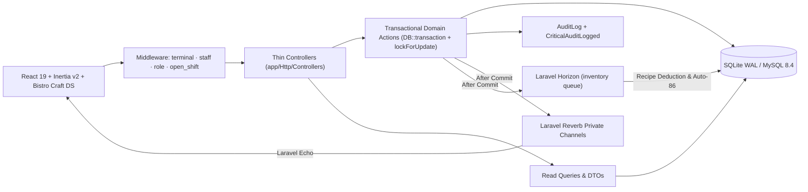

---

## 4. Tech Stack

| Layer | Technology | Version / Notes |
| --- | --- | --- |
| **Backend Runtime** | PHP | `^8.3` (CI verified on PHP `8.4`, Windows local `8.5`) |
| **Web Framework** | Laravel | `^13.17` |
| **Full-Stack Bridge** | Inertia.js (`inertia-laravel` / `@inertiajs/react`) | `^3.7` / `^3.11.0` |
| **Frontend Library** | React & TypeScript | React `^19.3.1`, TypeScript `^7.0.2` (`tsc --noEmit`) |
| **Styling & Design System** | Tailwind CSS v4 + Bistro Craft Primitives + `lucide-react` | `^4.0.0`, Plus Jakarta Sans + JetBrains Mono |
| **Animations** | `motion` (`motion/react`) | `^14.14.0` (`MotionConfig reducedMotion="user"`) |
| **UI Primitives** | `@radix-ui/react-{dialog,dropdown-menu,slot,switch,tabs}`, `cva` | Custom `MotionModal`, `MotionDrawer`, `PinKeypad`, `StatCard` |
| **Real-Time & Queues** | Laravel Reverb & Laravel Horizon + Redis | `laravel/reverb ^1.14`, `laravel/horizon ^5.52` |
| **Database** | SQLite (WAL) & MySQL `8.4` | Dual-DB tested in CI |
| **Testing & Arch** | Pest PHP + `pest-plugin-arch` + `pest-plugin-laravel` | `pest ^4.7`, `phpunit ^12.5.12` |
| **Bundler** | Vite | `^8.3.8` (`npm run build`) |

---

## 5. Implementation Stages

- **Phase 0 — Foundation & Strict Accounting**: Bootstrapped multi-branch schema, `StaffRole` RBAC, `TaxCalculator` (`intdiv` basis points & cents), immutable `AuditLog`, and `ModuleBoundariesTest` Pest Arch rules.
- **Phase 1 — Floor, Menu & POS Orders**: Implemented zone/table state machines, table transfers, branch menu overrides, modifiers, draft cart mutations, multi-round kitchen firing, and PIN-protected discounts & voids.
- **Phase 2 — KDS Real-Time Kitchen Routing**: Built prep-station ticket routing, per-item bump workflow, Expo serve validation (`TicketNotReadyForExpoException`), SLA timers, Web Audio chimes, and private Reverb channels (`branch.{branchId}.*`).
- **Phase 3 — Split Billing, Payments, Receipts & Shifts**: Built unified/equal/seat bill splitting, `SimulatedPaymentGateway` with idempotency keys, partial-payment recovery, refunds, 80mm thermal receipts, and blind cash shift reconciliation.
- **Phase 4 — Inventory, Analytics & Dual-DB CI**: Added recipe BOMs, sorted-lock async `DeductOrderInventoryJob` on Horizon's `inventory` queue, auto-86 stock syncing, executive reporting queries, and SQLite + MySQL `8.4` GitHub Actions CI.
- **Phase 5 — Regular POS Auth & Bistro Craft UI**: Replaced developer switchers with authentic two-layer Terminal Login + Staff PIN Lock screen, built the warm editorial "Bistro Craft" design system (`Plus Jakarta Sans` + `JetBrains Mono`, non-clipping `Button` heights, smooth charts, geometric floor tables, floating toasts, responsive sidebar/tablet rail/mobile drawer, compact floating POS pill), generated dish imagery + `DishArtwork` SVGs, and resolved full-system audit findings (`VoidReason` selector, draft qty stepper, cancel draft tab, multi-station KDS loading, `+ Add Menu Item`, blind-count Cashier isolation).

---

## 6. Modular Monolith & Domain Modules

All business logic is isolated inside `app/Modules/` with strict namespace isolation (`Tests\Architecture\ModuleBoundariesTest`):

| Module | Responsibilities | Key Actions / Queries / Services |
| --- | --- | --- |
| **`Restaurant`** | Multi-branch properties, tax & service rates, variance tolerances, PIN thresholds | `UpdateBranchSettingsAction`, `FindBranchByCodeOrIdQuery`, `Branch` |
| **`Identity`** | Two-layer terminal & PIN authentication, manager PIN verification, role gates | `SignInTerminalAction`, `UnlockStaffByPinAction`, `VerifyManagerPinAction`, `CurrentStaffContext`, `StaffRole` |
| **`Floor`** | Dining room zones, table capacities, states, transfers, server alerts | `UpdateTableStateAction`, `TransferTableAction`, `RequestTableServiceAction`, `GetBranchFloorQuery` |
| **`Menu`** | Catalog categories, dishes, SKU variants, modifiers, branch prices & 86 toggles | `CreateMenuItemAction`, `SetBranchPriceOverrideAction`, `ToggleBranchItemAvailabilityAction`, `GetBranchCatalogQuery` |
| **`Orders`** | Dine-in/takeaway tabs, modified line items, draft qty/cancel, firing & voiding | `OpenOrderTabAction`, `AddDraftOrderItemAction`, `UpdateDraftOrderItemQuantityAction`, `CancelDraftOrderAction`, `FireOrderRoundAction`, `ApplyOrderDiscountAction`, `VoidOrderItemAction`, `RecalculateOrderTotalsAction` |
| **`Kitchen`** | KDS tickets grouped by fire round, station item prep states, Expo gating | `BumpKitchenItemStatusAction`, `ServeKitchenTicketExpoAction`, `GetActiveKdsTicketsQuery` |
| **`Billing`** | Bill splits (unified, equal, seat), idempotent settlement, receipts & refunds | `RequestOrderBillAction`, `ReopenOrderFromBillingAction`, `SplitOrderBillAction`, `SettleBillSplitAction`, `RefundPaymentAction`, `BuildThermalReceiptAction` |
| **`Shifts`** | Register float open, expected cash movements, blind closing & variance PIN gate | `OpenShiftAction`, `CloseShiftAction`, `ApproveShiftVarianceAction`, `RecordCashMovementAction`, `GetBranchShiftsQuery` |
| **`Inventory`** | Ingredients, branch stock levels, recipe BOMs, async deductions & auto-86 sync | `DeductRecipeIngredientsAction`, `ReceiveSupplierStockAction`, `RecordManualWastageAction`, `SyncVariantAvailabilityFromStockAction`, `DeductOrderInventoryJob` |
| **`Reporting`** | Revenue, AOV, COGS %, category splits, peak hours & branch benchmarking | `GetDashboardOverviewQuery`, `GetExecutiveDashboardMetricsQuery` |
| **`Audit`** | Append-only governance event log & critical security event dispatch | `RecordAuditLogAction`, `GetBranchAuditLogsQuery`, `CriticalAuditLogged` |

---

## 7. User Personas, Roles & Seeded Credentials

Aurelia defines **8 distinct staff roles** in [`App\Modules\Identity\Enums\StaffRole`](app/Modules/Identity/Enums/StaffRole.php). Multi-branch roles (`sysadmin@aurelia.test`, `owner@aurelia.test`) can switch between branches from the header; single-branch staff are locked to their assigned branch (`dtf`, `wfp`, or `apx`).

### Role Permission Matrix

| Role | Terminal Login (`POST /login`) | Switch Branch | Manager PIN Override | Home Route | Allowed Workspaces |
| --- | :---: | :---: | :---: | --- | --- |
| **Enterprise System Admin** | Yes | Yes | Yes | `/dashboard` | All 10 workspaces |
| **Restaurant Owner** | Yes | Yes | Yes | `/dashboard` | All 10 workspaces |
| **Branch Manager** | Yes | No | Yes | `/dashboard` | All 10 workspaces |
| **Cashier** | No | No | No | `/pos` | `pos`, `orders`, `tables`, `shifts` *(blind close)* |
| **Waiter / Server** | No | No | No | `/tables` | `tables`, `pos`, `orders` |
| **Chef / Kitchen Staff** | No | No | No | `/kitchen` | `kitchen` *(defaults to assigned station tab)* |
| **Kitchen Expediter (Expo)** | No | No | No | `/kitchen` | `kitchen` |
| **Inventory Manager** | No | No | No | `/inventory` | `inventory`, `menu`, `reports` |

> **Customize vs. Manage Menu:** Any **POS user** (`Admin`, `Owner`, `Manager`, `Cashier`, `Waiter`) can tap `+ Customize` / `+ Add` on `/pos` to choose portions, modifiers, seat numbers, and kitchen notes for a guest order (which auto-prompts **Create New Order** if no tab is active yet). Catalog creation, `86` stock toggles, and branch price overrides on `/menu` are restricted to **Managers, Owners, Admins, and Inventory Managers**.

### Seeded Reviewer Accounts (Password: `password`)

| Role | Seeded Email (`{branch}` = `dtf` \| `wfp` \| `apx`) | 4-Digit PIN |
| --- | --- | --- |
| Enterprise System Admin | `sysadmin@aurelia.test` | `1234` |
| Restaurant Owner | `owner@aurelia.test` | `1234` |
| Branch Manager | `branch_manager.{branch}@aurelia.test` | `1234` |
| Cashier | `cashier.{branch}@aurelia.test` | `1111` |
| Waiter / Server | `waiter.{branch}@aurelia.test` | `2222` |
| Chef / Kitchen Staff | `chef.{branch}@aurelia.test` | `3333` |
| Kitchen Expediter (Expo) | `kitchen_expediter.{branch}@aurelia.test` | `4444` |
| Inventory Manager | `inventory_manager.{branch}@aurelia.test` | `5555` |

---

## 8. Core User Flows

### A. Terminal Activation, Staff PIN Switching & POS-to-KDS-to-Inventory Flow

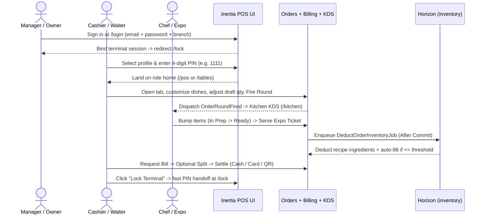

### B. Order & Kitchen Item State Machine

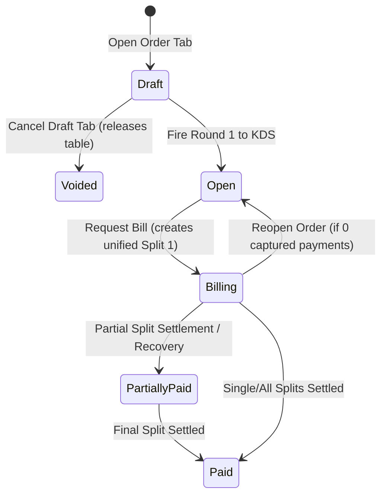

---

## 9. Entity-Relationship Diagram (ERD)

All domain relationships across the 25 application tables defined in `database/migrations/`:

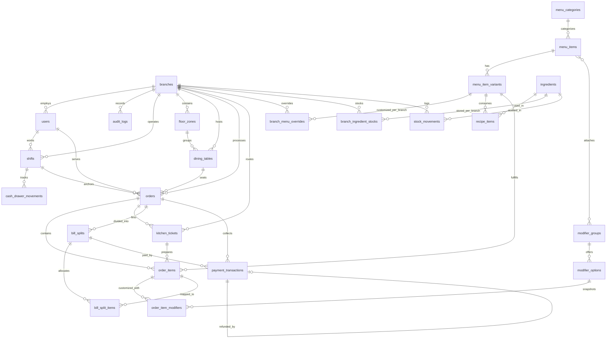

---

## 10. Application Features & Workspaces

| Route | Workspace | Core Capabilities |
| --- | --- | --- |
| `/login` | **Terminal Sign-In** | Manager/Owner/Admin terminal authentication bound to `DTF`, `WFP`, or `APX`. |
| `/lock` | **Staff PIN Lock Screen** | Filtered branch staff cards, spring PIN keypad with keyboard input & wrong-PIN shake, Manager PIN terminal unlink. |
| `/dashboard` | **Manager Dashboard** | Today Revenue, Paid Orders, Dine-In Tabs & Takeaway KPIs (`StatCard` sparklines), monotone cubic Daily Sales curve with hover tooltips, Category & Table donuts, Trending & 86'd lists. |
| `/pos` | **POS Register** | Active order switcher, wrapped category filter tabs + search, dish photos + SVG `DishArtwork`, seamless tab-auto-prompt on `+ Customize`, `ModifierSheet`, draft quantity `−/+` stepper & `Cancel Tab`, round firing, PIN discounts/voids (`VoidReason` selector), mobile floating `View Ticket` pill + drawer. |
| `/orders` | **Orders Board** | Stage filter tabs (`All`, `In Progress`, `Ready / Billing`, `Completed`), slide-over order inspection drawer, 80mm thermal receipt preview/print, `UnifiedPaymentModal` (`Cash` keypad, animated NFC `Card` approve/decline, `QR`), PIN-protected refunds. |
| `/tables` | **Dining Floor Plan** | Zone filter tabs, architectural dot-grid canvas, geometric table tiles (`round`/`square`/`banquet`) with perimeter seat capsules, live tab totals & timers, guest seating, table transfers, server alerts. |
| `/kitchen` | **Kitchen Display (KDS)** | High-contrast dark `#0D0F14` / `#161922` interface, station tabs (`All Stations / Expo` + 4 prep lines), SLA countdown pills, audio chimes, item bump & Expo serve actions. |
| `/menu` | **Menu Management** | `+ Add Menu Item` catalog creation modal, real-time `86` availability switches, branch price overrides & resets. |
| `/inventory` | **Inventory & Recipes** | Ingredient ledger, low-stock & auto-86 status alerts, supplier delivery drawer, wastage recording drawer, recipe COGS movement ledger. |
| `/reports` | **Financial Reports & Audit** | Date-range & branch-scoped P&L metrics, 24-hour dining throughput bar chart, cross-branch comparison cards, searchable critical/all governance audit log with JSON inspection. |
| `/shifts` | **Cash Drawer & Shifts** | Shift opening float, role-aware blind close (Cashiers do not see expected drawer total), automated variance detection & Manager PIN variance approval. |
| `/settings` | **Branch Settings** | Tax rate (bps), service charge (bps), discount PIN threshold (bps), cash variance tolerance (cents), timezone, terminal unlink. |

---

## 11. Screenshots

### Terminal Sign-In & Staff PIN Lock Screen
| Terminal Device Activation (`/login`) | Staff PIN Lock Screen (`/lock`) |
| :---: | :---: |
| 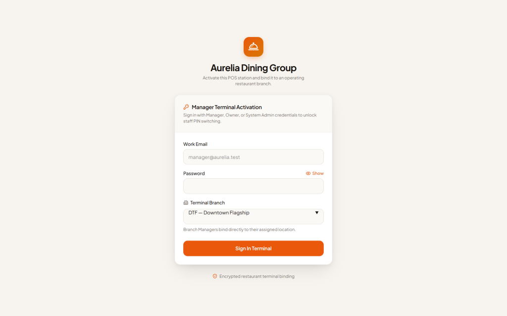 | 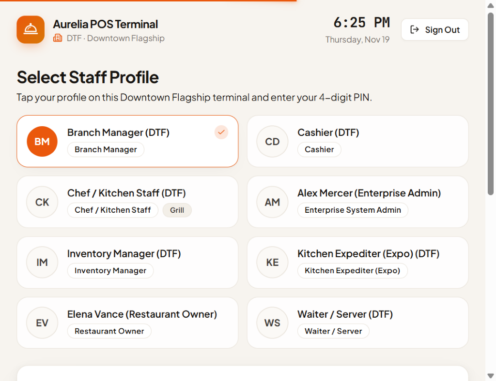 |

### Manager Dashboard & POS Register
| Operations Dashboard (`/dashboard`) | POS Register (`/pos`) |
| :---: | :---: |
| 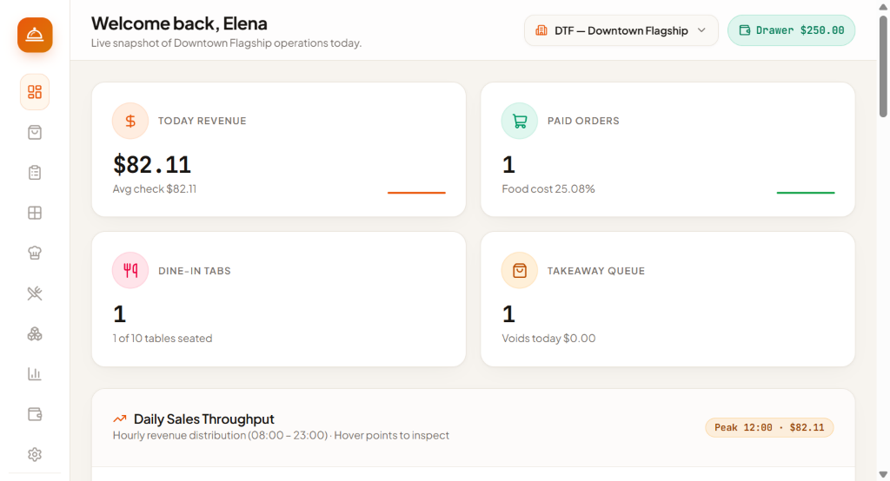 | 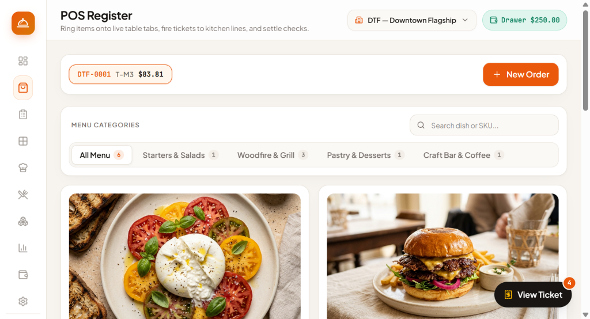 |

### Split Payment Settlement & Architectural Floor Plan
| Unified Payment Settlement Modal | Dining Room Floor Plan (`/tables`) |
| :---: | :---: |
| 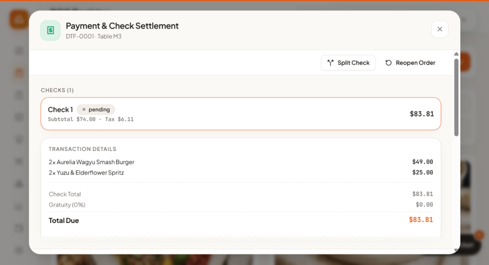 | 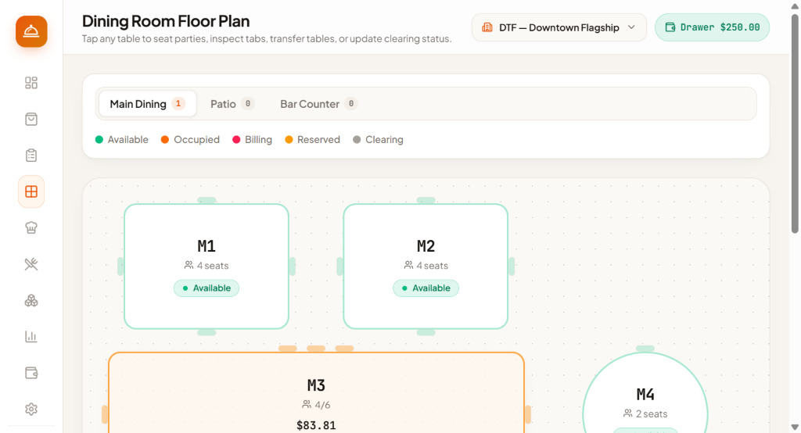 |

### Kitchen Display System & Mobile POS
| Dark Kitchen Display System (`/kitchen`) | Mobile Responsive POS (`375×812`) |
| :---: | :---: |
| 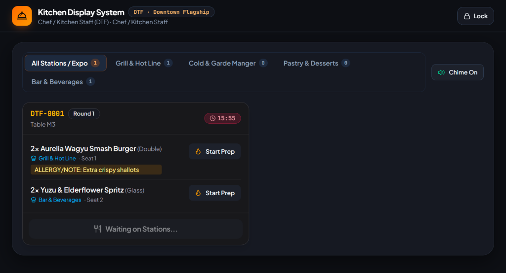 | 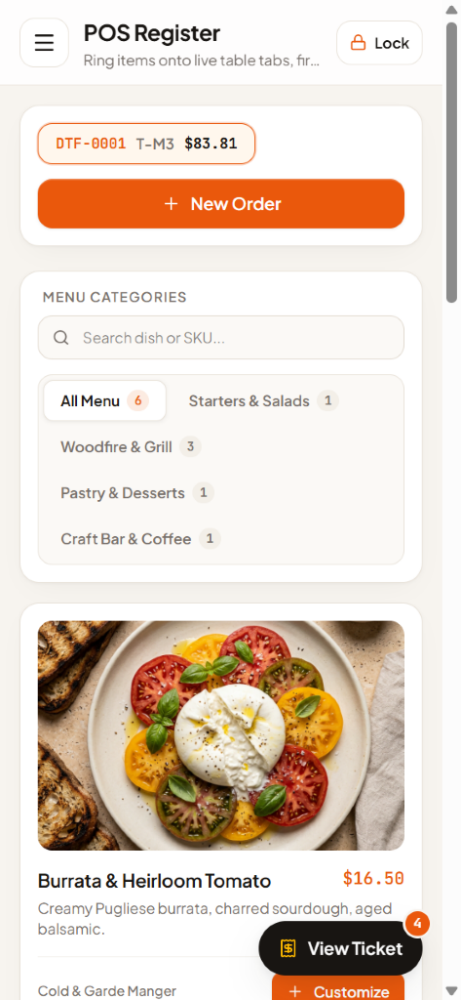 |

---

## 12. Running, Walkthrough & Automated Testing

### Prerequisites
- PHP `^8.3` with SQLite / MySQL PDO extensions
- Composer & Node.js `22+` / npm
- *(Optional for live WebSockets & async Horizon worker)* Redis `7+`

### 1. Local Installation & Startup

```bash
# Install backend and frontend dependencies
composer install
npm install

# Configure environment and application key
cp .env.example .env
php artisan key:generate

# Prepare SQLite database & run migrations + full demo seeder
touch database/database.sqlite   # PowerShell: New-Item database/database.sqlite -Force
php artisan migrate:fresh --seed

# Build production frontend assets (or use `npm run dev` for HMR)
npm run build

# Start Laravel server
php artisan serve
```

> **Optional Real-Time Services:** To run live WebSocket broadcasting and queued recipe deductions alongside the HTTP server, set `BROADCAST_CONNECTION=reverb` / `QUEUE_CONNECTION=redis` in `.env` and start `php artisan reverb:start` and `php artisan horizon` (or `php artisan queue:work` on Windows/SQLite). Default `.env.example` runs synchronously out of the box with zero extra daemons needed.

### 2. Guided Reviewer / User Walkthrough

1. Open `http://127.0.0.1:8000/login` and sign in with `owner@aurelia.test` / `password` bound to **`DTF — Downtown Flagship`**.
2. On `/lock`, tap **Waiter / Server (DTF)** (`2222`) to land on `/tables`, or tap **Cashier (DTF)** (`1111`) to open `/pos`.
3. **Seeded Sample State (`DTF`):** Table `M3` already has open order `DTF-0001` (`$83.81`) fired to Kitchen KDS (`Grill & Hot Line` + `Bar & Beverages`), and `Butter-Poached Lobster Thermidor` (`ING-LOBSTER`) starts out-of-stock / `86`'d so you can test low-stock restoration immediately.
4. **Ring, Customize, Adjust & Cancel:** Tap **+ Customize** on any dish, modify portions/notes, test the `− / +` stepper on draft rows, test **Cancel Tab** on an unfired draft order, or click **Send to Kitchen** to fire tickets to `/kitchen`.
5. **Switch Role via Lock Terminal:** Click **Lock Terminal** in the sidebar/header, unlock **Chef / Kitchen Staff (DTF)** (`3333`) to bump items on `/kitchen`, switch to **Kitchen Expediter (Expo)** (`4444`) to serve ready tickets, then unlock **Elena Vance (Restaurant Owner)** (`1234`) to settle splits via Cash/Card/QR, restock Lobster on `/inventory` (watching auto-un-86), and inspect `audit_logs` on `/reports`.

### 3. Running Automated Tests, Typechecks & CI

```bash
# Run all Pest Feature, Unit & Architecture tests (67 tests / 601 assertions)
php vendor/bin/pest

# Strict TypeScript verification
npm run types

# Production Vite build check
npm run build
```

GitHub Actions (`.github/workflows/ci.yml`) automatically runs the full Pest suite against **both SQLite (`:memory:`) and MySQL `8.4`** plus `npm run types` and `npm run build` on pushes to `main` and `feat/**`.
