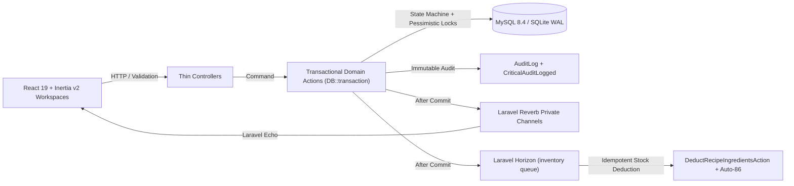

# Aurelia Dining Group — Enterprise Restaurant POS & Station-to-Expediter KDS

Production-grade **Multi-Branch Restaurant Point of Sale & Kitchen Display System** built as a **Modular Monolith** with Laravel 13, PHP 8.3+, React 19, TypeScript, Inertia.js v2, Tailwind CSS v4, `shadcn/ui`, `motion.dev`, **SQLite (WAL) / MySQL 8.4+**, **Laravel Reverb**, and **Laravel Horizon**.

Designed from the ground up for **zero-friction technical evaluation** and **senior engineering code review**.

---

## Zero-Friction Evaluator Guide

Open `/` after running migrations & seeding (`php artisan migrate:fresh --seed`) — no signup or credential hunt is needed. A persistent **Evaluator Control Bar** at the top of every page lets you:

1. **Switch Between All 8 RBAC Roles (1-Click Persona Switch):**
   - `Enterprise System Admin`, `Restaurant Owner`, `Branch Manager`, `Cashier`, `Waiter / Server`, `Chef / Kitchen Staff`, `Kitchen Expediter (Expo)`, and `Inventory Manager`.
2. **Switch Branches Across `Aurelia Dining Group`:**
   - **DTF** — *Downtown Flagship* (`8.25%` tax, `5%` service charge, Maine Lobster intentionally 86'd due to 0 stock)
   - **WFP** — *Waterfront Patio* (`8.50%` tax, `6%` service charge)
   - **APX** — *Airport Express* (`9.25%` tax, `0%` service charge, custom airport menu price override on Single Wagyu Smash Burger)
3. **Authorize Loss-Prevention Operations with Manager PIN:**
   - Default Manager PIN: **`1234`** (required for post-fire item voids, discounts above branch threshold, refunds, and blind cash shift variance approvals).
4. **Trigger Failure & Edge-Case Simulations Live:**
   - `Simulate Card Decline` → triggers `BillSplitState::Failed` recovery flow in `SettleBillSplitAction`.
   - `Trigger Low-Stock Auto-86` → drops the primary recipe ingredient to `auto_86_threshold` on ticket serve and broadcasts `ItemAvailabilityChanged` over Reverb.

### Key Workspaces

| Route | Purpose |
| --- | --- |
| `/` | Enterprise Control Center & branch menu override / 86 manager |
| `/demo/split-screen` | **Split-Screen POS ↔ KDS Live Demo** side-by-side in one viewport |
| `/floor` | Real-time dining room floor map, zone table states, and mid-service table transfer |
| `/pos` | Open-tab POS terminal, modifier sheets, multi-round ticket firing, 3-mode split billing, and 80mm thermal receipts |
| `/kds` | Station-routed Kitchen Display (`Grill`, `ColdSalad`, `Pastry`, `Bar`), SLA bump timers, Web Audio chime, and Expo handoff |
| `/executive` | Consolidated & per-branch P&L analytics, 24h peak-hour chart, COGS % & wastage, recipe inventory stock-in drawer, and immutable Audit Log inspector (Owner / Manager / Inventory / Admin only) |

---

## Architecture & Engineering Invariants



- **Strict Integer Accounting (Zero Floats):** All currency is stored and calculated in signed/unsigned integer cents (`*_cents`), and all tax/service/discount/COGS ratios are computed in integer basis points (`*_bps`) using `intdiv`.
- **Modular Monolith Boundaries (`tests/Architecture/ModuleBoundariesTest.php`):** Enforced automatically by Pest Arch tests — all classes under `App\Modules\*` and `App\Support\*` declare `strict_types=1`, controllers cannot bypass domain Actions via `DB` facade, and domain modules have zero dependencies on `App\Http`.
- **Concurrency & Idempotency:**
  - Payment capture (`SettleBillSplitAction`) uses pessimistic row locking (`lockForUpdate()`) inside `DB::transaction()` and enforces idempotent `idempotency_key` replay protection.
  - Recipe ingredient deductions (`DeductOrderInventoryJob`) run on Horizon's `inventory` queue after transaction commit (`ShouldDispatchAfterCommit`), lock stock rows in sorted ingredient-ID order to prevent deadlocks, and enforce database-level idempotency via a composite unique index on `stock_movements(branch_id, reference_type, reference_id, ingredient_id)`.
- **Dual-Database Parity:** Zero PostgreSQL-specific functions; all migrations, locks, and reporting queries pass cleanly on both **SQLite** and **MySQL 8.4** in CI.

---

## Local Development & Verification

### Initial Setup

```bash
composer install
npm install
cp .env.example .env
php artisan key:generate
php artisan migrate:fresh --seed
```

### Running the Full Stack Locally

Run any of the following services as needed:

```bash
php artisan serve
npm run dev
php artisan reverb:start
php artisan horizon
```

### Verification Commands

```bash
# Pest test suite (Unit, Architecture, Feature, Concurrency & HTTP Inertia)
php vendor/bin/pest

# TypeScript strict typecheck
npm run types

# Production asset bundle
npm run build
```

---

## Continuous Integration

[`.github/workflows/ci.yml`](.github/workflows/ci.yml) runs on every push and pull request across:
- **`backend-tests (sqlite)`** — `php artisan migrate:fresh --seed --force` + `php vendor/bin/pest`
- **`backend-tests (mysql)`** — MySQL `8.4` & Redis `7` service containers + `php artisan migrate:fresh --seed --force` + `php vendor/bin/pest`
- **`frontend-checks`** — Node `22` + `npm ci` + `npm run types` + `npm run build`
